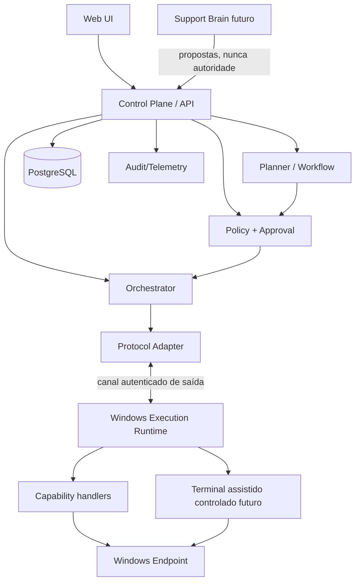
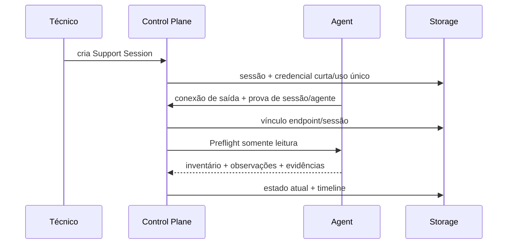

# Arquitetura conceitual v0.1

Status: baseline aceita na GATE-000. Esta arquitetura descreve limites lógicos, não processos implantáveis obrigatórios.

## Direção

Começar com um **Control Plane em monólito modular**, uma Web UI e um **Execution Runtime Windows** separado por fronteira de confiança. AI/Support Brain é uma integração futura e não fica no caminho obrigatório de autorização. PostgreSQL é o system of record candidato. O protocolo é definido por contratos versionados, não pelo túnel.

## Componentes e limites

- **Web UI:** apresenta ativos, sessão, evidências, hipóteses explícitas, propostas, aprovações, jobs e timeline. Não decide autorização.
- **Control Plane/API:** identidade, casos de uso e fronteira externa. Não executa comandos locais.
- **Planner/Workflow:** mantém plano explícito e adapta próximos passos a resultados. Inicialmente determinístico/humano.
- **Verifier:** compara condição esperada com Evidence pós-ação e classifica verificação; é diferente do executor.
- **Policy/Approval:** calcula decisão com base em risco/contexto e valida aprovação específica. É autoridade exclusiva para liberar ação.
- **Orchestrator:** lifecycle, fila, lease, timeout, cancelamento, retry e correlação de Jobs; não interpreta sucesso clínico/operacional.
- **Knowledge/Incident Memory:** inventário, estado atual, histórico e casos; não transforma inferência em fato confirmado.
- **Protocol Adapter:** traduz contratos de aplicação para o canal escolhido e isola WebSocket/túnel.
- **Execution Runtime:** autentica servidor, valida envelope/política local, despacha handlers permitidos, aplica limites e devolve resultado/evidência.
- **Capability handlers:** operações tipadas e versionadas com precondições, risco declarado e verificador esperado.
- **AI Gateway futuro:** recebe contexto minimizado/redigido, registra propostas e trata retornos como não confiáveis.
- **Storage:** estado transacional e eventos de auditoria. Artefatos grandes poderão migrar a object storage mediante necessidade.

## Fluxo de sessão

## Fluxo de Job, aprovação e verificação

1. Técnico/planner propõe uma Action baseada em evidências e resultado esperado.
2. Policy classifica risco e retorna `deny`, `allow` ou `approval_required`.
3. Approval, quando necessária, é vinculada ao hash/versão da ação, endpoint, sessão, aprovador e expiração; alteração invalida-a.
4. Orchestrator cria Job idempotente/leaseado e o adapter entrega pelo canal autenticado.
5. Runtime valida sessão, versão, prazo, replay, capability e limites locais; só então executa.
6. CommandExecution registra resultado técnico e Evidence; retry nunca é implícito para ação não idempotente.
7. Verifier solicita/avalia estado posterior independente e produz `verified`, `not_verified`, `partially_verified` ou `inconclusive`.
8. O plano encerra, adapta ou escala. `ExitCode 0` é apenas um dado.

## Encerramento

O Control Plane marca a sessão como encerrando, cancela/aguarda Jobs conforme política, recebe confirmação quando possível, revoga credenciais e leases, fecha o canal e registra evento final. Conexões tardias e resultados após revogação são rejeitados/quarentenados, nunca anexados silenciosamente.

## Protocolo e compatibilidade

Os nomes de campos ainda não estão congelados, mas toda mensagem Agent ↔ Control Plane deverá possuir conceitos equivalentes a: versão do protocolo, identificador único da mensagem, tipo, sessão, correlação quando aplicável, timestamp e expiração/TTL quando aplicável. O protocolo deve definir deduplicação, rejeição explícita de mensagens incompatíveis e tipos distintos para comando recebido, acknowledgement de recebimento, início/estado de execução e resultado.

No handshake, o agente informa conceitos equivalentes a versão do agente, versões de protocolo compreendidas e capabilities suportadas com suas versões. O servidor seleciona somente uma combinação compatível, pode rejeitar o agente e jamais envia Job para capability não negociada. A evolução deve favorecer mudanças aditivas e uma janela de compatibilidade, sem exigir atualização simultânea de todos os participantes. O mecanismo exato de negociação será definido por contrato na FOUNDATION-001.

WebSocket permanece somente candidato para spike; essas semânticas não podem depender dele.

## Estados mínimos

- Session: `Created → Connecting → Active → Closing → Closed|Expired|Failed`.
- Action/Approval precedem o Job. O lifecycle mínimo do Job é `Created → Queued → Dispatched → Acknowledged → Running → Succeeded|Failed|TimedOut|Cancelled|Expired`.

Transições normais avançam da esquerda para a direita. `Queued` pode terminar em `Cancelled` ou `Expired`; `Dispatched` e `Acknowledged` podem terminar em `Cancelled`, `Expired` ou `TimedOut` conforme política; `Running` termina em `Succeeded`, `Failed`, `TimedOut` ou `Cancelled`. Estados terminais não transitam novamente. Mensagem inválida/incompatível rejeita o dispatch e é auditada; não cria sucesso fictício. Recuperação após falha poderá reconciliar estado observado sem reexecutar automaticamente.

`Acknowledged` significa somente recebimento e aceitação inicial. `Succeeded` significa que a execução terminou conforme o contrato técnico da capability; não significa que o problema foi resolvido. Resolution depende de Verification posterior. Um Job é a intenção orquestrada; cada tentativa concreta é uma CommandExecution, portanto um Job pode ter zero ou mais tentativas sem perder seu histórico.

## Idempotência, retry e resultado desconhecido

Retry não é padrão. Cada capability deverá declarar semântica equivalente a: segura para retry, idempotente, não idempotente ou destrutiva. Essas propriedades não são sinônimas. Se o agente executar uma ação e a conexão cair antes do resultado, o estado é **resultado desconhecido**: o servidor reconcilia por consulta/evidência ou exige decisão humana conforme risco; não presume falha e não repete a ação automaticamente.

## Contratos entre TypeScript e C#

Manter uma fonte de verdade neutra (OpenAPI para HTTP e JSON Schema para mensagens/eventos inicialmente), com exemplos canônicos e testes de compatibilidade em ambas as linguagens. Código gerado é adaptador, não domínio. Contratos têm versão, política de compatibilidade e evolução additive-first. Protobuf/gRPC só será adotado se métricas justificarem.

## Restrições arquiteturais

- Sem acesso direto da UI, IA ou banco ao executor.
- Sem PowerShell arbitrário como protocolo primário.
- Sem dependência de Cloudflare no domínio.
- Sem transformar cada módulo lógico em microserviço.
- Auditoria é append-only conceitualmente no banco da aplicação; isso não equivale a inviolabilidade criptográfica. Estado atual é projeção transacional e não substitui histórico.
