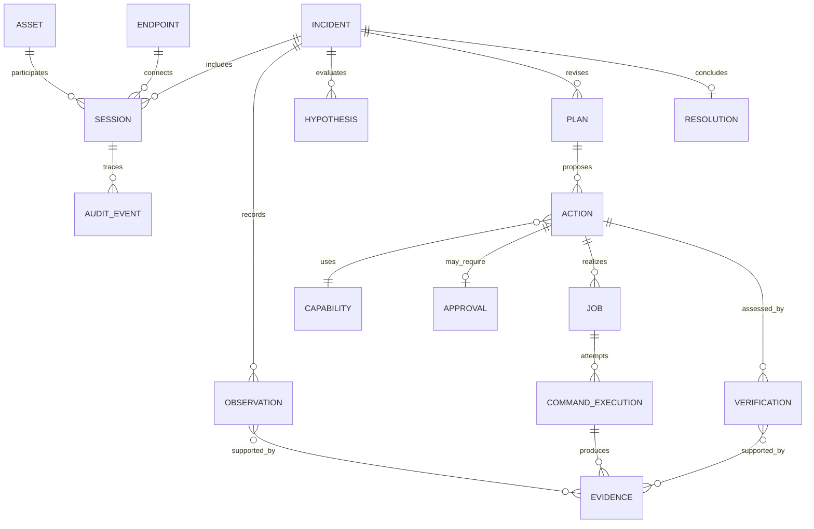

# Modelo de domínio v0.1

## Asset e AssetEndpointLink implementados

`Asset` possui UUID gerado pelo sistema, `AssetType=WindowsEndpoint`, `DisplayName`, `ExternalInventoryId` opcional e único, status `Active|Retired` e timestamps. `AssetEndpointLink` é a decisão humana persistida: identifica Asset e ObservedEndpoint, registra `HumanReview`, ator transitório `local_operator`, instante e status `Active|Revoked`. Um endpoint tem no máximo um vínculo ativo; um Asset pode reunir vários endpoints ao longo das Sessions.

Correção nunca edita o alvo histórico: revoga o link anterior e cria outro na mesma transação, com razão e AuditEvents. Asset aposentado continua consultável e bloqueia novos links. Current view é projeção derivada; a navegação histórica segue Asset → links → ObservedEndpoints → Sessions → PreflightRuns → Observations. Nenhum fato observado concede identidade automaticamente.

## PreflightRun, PreflightSnapshot e ObservedEndpoint

`PreflightRun` é uma execução temporal vinculada a uma Support Session autenticada e percorre `Running` até `Completed`, `Partial`, `Failed`, `Cancelled` ou, por reconciliação de restart, `Interrupted`. Cada capability mantém sua própria ObservationRequest e falha; o estado agregado nunca inventa dados ausentes.

`PreflightSnapshot` registra instante, versões, completude, classificação e referências às Observations persistidas, sem copiar Evidence RAW. `ObservedEndpoint` significa somente “um endpoint foi observado nesta Session”; contém `ObservedMachineName` quando disponível. Não é `Asset`, não confirma identidade e não é correlacionado entre Sessions por hostname, OS, RAM ou discos.

## SupportInvitation e credenciais temporárias

`SupportInvitation` autoriza exatamente um bootstrap e possui InvitationId, SecretHash, issuer transitório `local_operator`, CreatedAt, ExpiresAt, UsedAt, RevokedAt e Status. Ela não afirma identidade permanente do Asset/Endpoint. ConnectionTicket autoriza uma abertura WSS; ResumeTicket autoriza uma retomada da mesma Session/AgentInstance e gira após uso. Ambos são autoridade efêmera, não entidades históricas persistidas.

Status: conceitual. Cardinalidades, campos e agregados serão validados por casos de uso antes de virar esquema físico.

## Entidades e conceitos

| Conceito | Responsabilidade e identidade | Estado nesta versão |
|---|---|---|
| Asset | Coisa suportada, identificada por `AssetId`; agrega identidade, tipo, criticidade e conhecimento com procedência. | núcleo |
| Endpoint | Papel/especialização de Asset capaz de hospedar Runtime; Windows Endpoint é o primeiro subtipo operacional. | núcleo |
| AgentInstance | Processo/instância concreta do Runtime, com versão e conexão próprias; não é identidade do Asset nem do Endpoint. | núcleo |
| Session | Janela temporária e autenticada que vincula técnico, endpoint, política e lifecycle. | núcleo |
| Job | Unidade orquestrada de trabalho: intenção, capability, parâmetros, alvo, prazos, política e estados. | núcleo |
| Capability | Operação tipada/versionada, com esquema de entrada/saída, precondições, privilégios, risco e estratégia de verificação. | núcleo |
| CommandExecution | Tentativa concreta de executar um Job; captura executor, tempos, saída, erro, exit code, timeout, cancelamento e reboot. | núcleo |
| Evidence | Registro imutável e referenciável de dado observado, fonte, horário, coleta, integridade e sensibilidade. | núcleo |
| Observation | Afirmação factual sustentada por Evidence; não contém causalidade presumida. | núcleo |
| Hypothesis | Explicação testável, com confiança, evidências pró/contra e status. | conceitual inicial |
| Plan | Sequência revisável de passos e critérios de parada/escalonamento. | conceitual inicial |
| Action | Intervenção pretendida/realizada, seu objetivo, efeito esperado, risco e reversibilidade. Pode originar Job. | núcleo |
| Verification | Avaliação pós-ação independente do resultado técnico, ligada a critério esperado e novas evidências. | núcleo |
| Incident | Caso de atendimento que agrega sintoma, contexto, raciocínio explícito, timeline e desfecho. | núcleo |
| Resolution | Desfecho sustentado por Verification, incluindo solução, efeitos colaterais, confiança e pendências. | conceitual inicial |
| Approval | Consentimento específico, limitado e expirável para uma Action imutável em determinado contexto. | núcleo |
| RiskLevel | Classificação conceitual R0–R4; não é autorização por si só. | provisório |
| AuditEvent | Evento append-only de segurança/operação com ator, ação, alvo, correlação, tempo e resultado. | núcleo |
| ServerInstance | Execução concreta do Control Plane, com UUID novo por startup e `startedAt/endedAt`; não é membership de cluster. | implementado |
| SessionRecord | Histórico durável de uma Session e de seu encerramento; não contém conexão, lease, token nem autoridade. | implementado |

Na FOUNDATION-005, `ObservationRequest` continua um caso de uso operacional, não um Job, mas seu histórico mínimo agora é persistido. Referencia SessionRecord, ServerInstance e Capability negociada, possui `requestId`, deadline e lifecycle `created/accepted/executing/completed|failed|timed_out|cancelled|abandoned`. `outcomeUnknown` durável qualifica abandono quando o Server não pode afirmar se houve execução. Evidence continua RAW e efêmera; somente EvidenceMetadata e a Observation determinística minimizada são persistidas.

## Relações principais

## Distinções obrigatórias

- **Inventário:** propriedades relativamente estáveis do Asset, sempre com fonte e validade.
- **Estado ao vivo:** observação temporal, nunca sobrescrita sem preservar proveniência/histórico.
- **Memória operacional:** incidentes, ações, resultados e lições anteriores.
- **Discovered:** coletado diretamente; **Inferred:** derivado com método/confiança; **Confirmed:** validado por autoridade/processo explícito. Esses estados qualificam afirmações, não o Asset inteiro.
- **Job ≠ Execution:** um Job pode ter tentativas; cada tentativa é uma CommandExecution.
- **Execution result ≠ Verification ≠ Resolution.**
- **Evidence ≠ Observation:** evidência é o artefato/dado; observação é a afirmação sustentada.
- **ObservationRequest ≠ Job:** a primeira coordena coleta R0 read-only; um Job futuro poderá orquestrar Capability para uma Action, sem fundir conhecimento produzido com execução.
- **Execution outcome ≠ Reconciled outcome:** o Agent pode produzir um resultado que o Server rejeita ou classifica como tardio por perda de autoridade.
- **Reconciliation ≠ Verification:** reconciliação valida pertencimento, correlação e autoridade do resultado; verificação avalia o objetivo operacional.
- **Asset ≠ Endpoint observado ≠ AgentInstance ≠ Session:** um agente temporário pode abrir nova Session para o mesmo Asset; um endpoint observado pode permanecer não confirmado e não deve receber identidade confiável automaticamente.
- **Live Session ≠ SessionRecord:** apenas a primeira possui socket, lease, heartbeat, token e autoridade; o registro durável é histórico e jamais revive a primeira.
- **ServerInstance ≠ Control Plane cluster:** identifica qual processo detinha autoridade e permite reconciliação; não implementa eleição ou membership.

## Invariantes

1. Nenhuma Action de risco que exija Approval pode ser executada sem aprovação válida para seu conteúdo imutável.
2. Uma Verification referencia critério pré-declarado e Evidence posterior.
3. Todo Job pertence a Session e alvo definidos; não pode migrar de endpoint.
4. Toda transição relevante gera AuditEvent.
5. Saídas podem ser truncadas/redigidas, mas essa transformação deve ser declarada.
6. Encerrar Session impede novos leases e invalida autoridade ainda não consumida.
7. Correlação ou reconciliação de Endpoint observado com Asset preserva fonte, confiança e histórico; não cria confirmação implícita.
8. Estado terminal de ObservationRequest não reabre e resume não reexecuta request antiga automaticamente.
9. Ausência de resultado não prova ausência de execução; outcome desconhecido permanece explícito.
10. Restart cria nova ServerInstance, encerra registros vivos anteriores e não recria Session nem redispara ObservationRequest.
11. Evidence RAW não é persistida por padrão; Observation `MINIMIZED` não é implicitamente `AI-SAFE`.

## Ainda não decidido

Autenticação corporativa do operador, atestação criptográfica de equipamento, cardinalidade Incident–Session, retenção/expurgo, formato de evidências grandes e fronteira entre Action/Job continuam abertos. As transações da FOUNDATION-008 cobrem somente criação, vínculo, correção e retirement do Asset Registry descritos na ADR-014.
