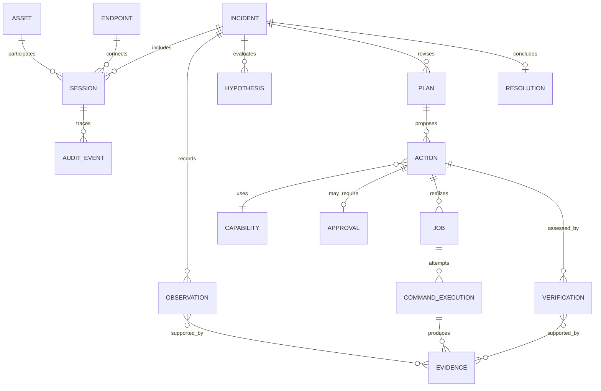

# Modelo de domínio v0.1

Status: conceitual. Cardinalidades, campos e agregados serão validados por casos de uso antes de virar esquema físico.

## Entidades e conceitos

| Conceito | Responsabilidade e identidade | Estado nesta versão |
|---|---|---|
| Asset | Coisa suportada, identificada por `AssetId`; agrega identidade, tipo, criticidade e conhecimento com procedência. | núcleo |
| Endpoint | Papel/especialização de Asset capaz de hospedar Runtime; Windows Endpoint é o primeiro subtipo operacional. | núcleo |
| AgentInstance | Processo/instância concreta do Runtime, com versão e conexão próprias; não é identidade do Asset nem do Endpoint. | núcleo |
| Session | Janela temporária e autenticada que vincula técnico, endpoint, política e lifecycle. | núcleo |
| Job | Unidade orquestrada de trabalho: intenção, capability, parâmetros, alvo, prazos, política e estados. | núcleo |
| Capability | Operação tipada/versionada, com esquema de entrada/saída, precondições, privilégios, risco e estratégia de verificação. | núcleo |
| CommandExecution | Tentativa concreta de executar um Job; captura executor, tempos, saída, erro, exit code, timeout, cancelamento e reboot. | núcleo |
| Evidence | Registro imutável e referenciável de dado observado, fonte, horário, coleta, integridade e sensibilidade. | núcleo |
| Observation | Afirmação factual sustentada por Evidence; não contém causalidade presumida. | núcleo |
| Hypothesis | Explicação testável, com confiança, evidências pró/contra e status. | conceitual inicial |
| Plan | Sequência revisável de passos e critérios de parada/escalonamento. | conceitual inicial |
| Action | Intervenção pretendida/realizada, seu objetivo, efeito esperado, risco e reversibilidade. Pode originar Job. | núcleo |
| Verification | Avaliação pós-ação independente do resultado técnico, ligada a critério esperado e novas evidências. | núcleo |
| Incident | Caso de atendimento que agrega sintoma, contexto, raciocínio explícito, timeline e desfecho. | núcleo |
| Resolution | Desfecho sustentado por Verification, incluindo solução, efeitos colaterais, confiança e pendências. | conceitual inicial |
| Approval | Consentimento específico, limitado e expirável para uma Action imutável em determinado contexto. | núcleo |
| RiskLevel | Classificação conceitual R0–R4; não é autorização por si só. | provisório |
| AuditEvent | Evento append-only de segurança/operação com ator, ação, alvo, correlação, tempo e resultado. | núcleo |

## Relações principais

## Distinções obrigatórias

- **Inventário:** propriedades relativamente estáveis do Asset, sempre com fonte e validade.
- **Estado ao vivo:** observação temporal, nunca sobrescrita sem preservar proveniência/histórico.
- **Memória operacional:** incidentes, ações, resultados e lições anteriores.
- **Discovered:** coletado diretamente; **Inferred:** derivado com método/confiança; **Confirmed:** validado por autoridade/processo explícito. Esses estados qualificam afirmações, não o Asset inteiro.
- **Job ≠ Execution:** um Job pode ter tentativas; cada tentativa é uma CommandExecution.
- **Execution result ≠ Verification ≠ Resolution.**
- **Evidence ≠ Observation:** evidência é o artefato/dado; observação é a afirmação sustentada.
- **Asset ≠ Endpoint observado ≠ AgentInstance ≠ Session:** um agente temporário pode abrir nova Session para o mesmo Asset; um endpoint observado pode permanecer não confirmado e não deve receber identidade confiável automaticamente.

## Invariantes

1. Nenhuma Action de risco que exija Approval pode ser executada sem aprovação válida para seu conteúdo imutável.
2. Uma Verification referencia critério pré-declarado e Evidence posterior.
3. Todo Job pertence a Session e alvo definidos; não pode migrar de endpoint.
4. Toda transição relevante gera AuditEvent.
5. Saídas podem ser truncadas/redigidas, mas essa transformação deve ser declarada.
6. Encerrar Session impede novos leases e invalida autoridade ainda não consumida.
7. Correlação ou reconciliação de Endpoint observado com Asset preserva fonte, confiança e histórico; não cria confirmação implícita.

## Ainda não decidido

Agregados transacionais, semântica exata de identidade de Asset, cardinalidade Incident–Session, enumerações finais, retenção, formato de evidências grandes e fronteira entre Action/Job serão fechados por exemplos na FOUNDATION-001, sem criar tabelas prematuramente.
